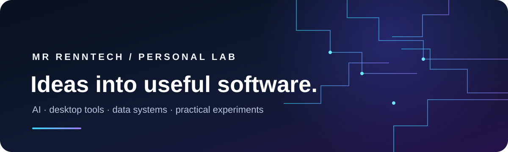

  
    
  
  

# Hey, I’m MrRenntech

I build practical software at the intersection of **AI, automation, analytics, and desktop tools**. This profile is my workshop: a mix of active products, experiments, and projects that help me learn by shipping.

## Featured work

| Project | What it does | Stack |
| --- | --- | --- |
| [Steel for Windows](https://github.com/MrRenntech/Steel-Releases) · [Downloads](https://github.com/MrRenntech/Steel-Releases/releases) | A Windows desktop assistant combining voice, local AI, and everyday tools. | Python · PySide6 · QML · Ollama |
| [AI Football Analysis Dashboard](https://github.com/MrRenntech/AI-football-analysis-dashboard) | Video analysis for player movement, possession, and match metrics. | Next.js · FastAPI · Computer Vision |
| [SmartFit AI Tracker](https://github.com/MrRenntech/SmartFit-AI-Tracker) | Workout and nutrition tracking with analytics and food image analysis. | React · FastAPI · SQLite |
| [Cyber Forensic LAB](https://github.com/MrRenntech/Cyber-Forensic-LAB) | An interactive forensic investigation and learning environment. | Node.js · MongoDB |
| [Flight Fare Prediction](https://github.com/MrRenntech/Flight-Fare-Prediction) | A machine-learning app for exploring airline fare estimates. | Python · Flask · scikit-learn |
| [Apex Analytics AI](https://github.com/MrRenntech/Apex---Analytics-AI-) | An employee-retention analytics dashboard with predictive insights. | Python · Flask · scikit-learn |

### More experiments

[Face Detection with OpenCV](https://github.com/MrRenntech/Face-Dectection-Opencv) · [AI Grade Prediction](https://github.com/MrRenntech/AI-Grade-Prediction) · [Phone Call utility](https://github.com/MrRenntech/Phone_Call.py)

## Tools I work with

## What I’m focused on

- Making **Steel** a capable, private-first desktop assistant.
- Turning computer-vision and machine-learning ideas into usable tools.
- Improving projects through hands-on building, testing, and iteration.

## Explore

- [All repositories](https://github.com/MrRenntech?tab=repositories)
- [Steel for Windows](https://github.com/MrRenntech/Steel-Releases) · [Steel releases](https://github.com/MrRenntech/Steel-Releases/releases)

  Designed and built by MrRenntech · Always learning, always shipping.

